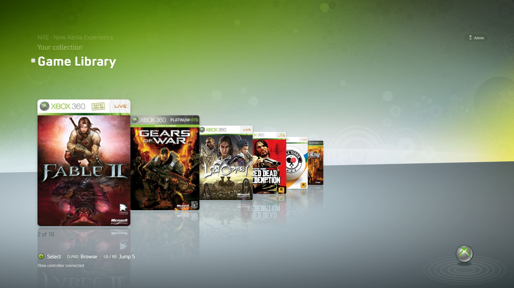
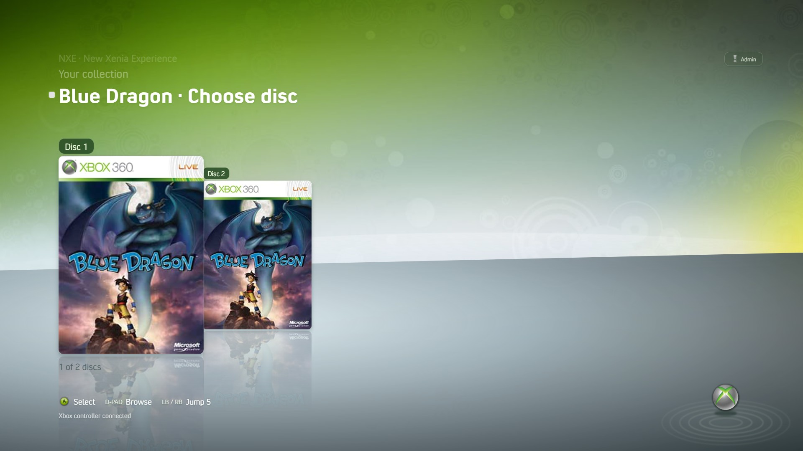
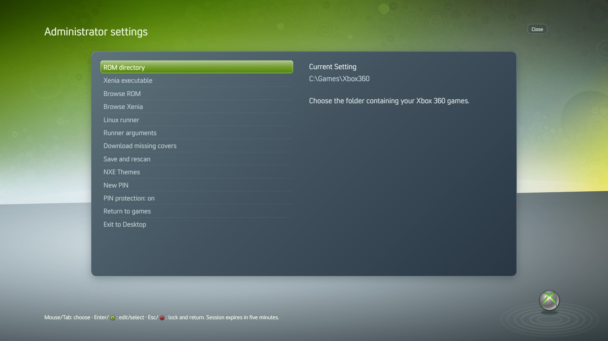
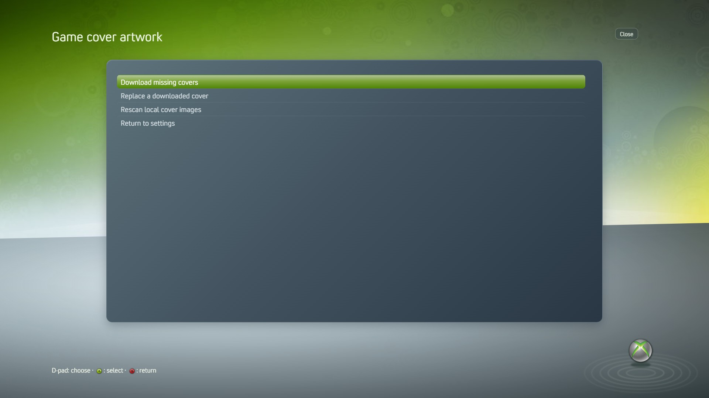
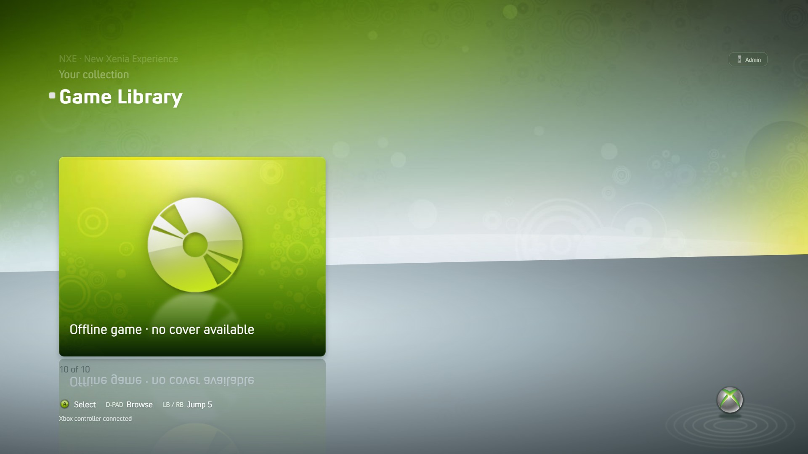
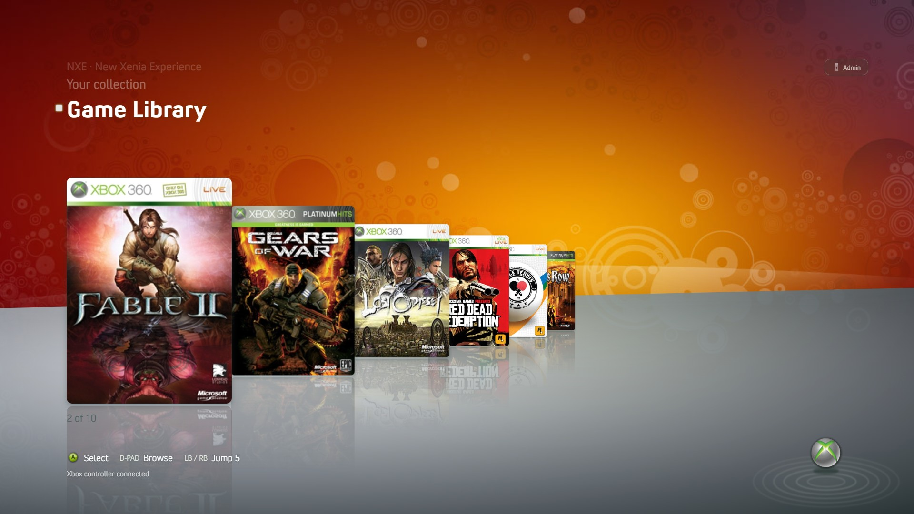
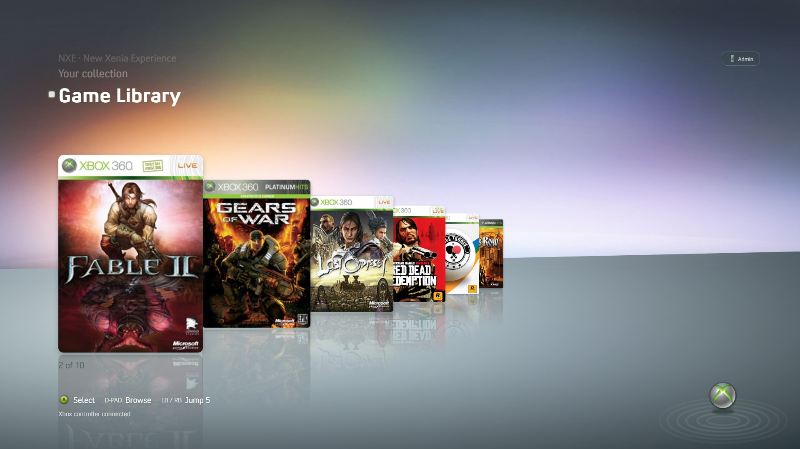
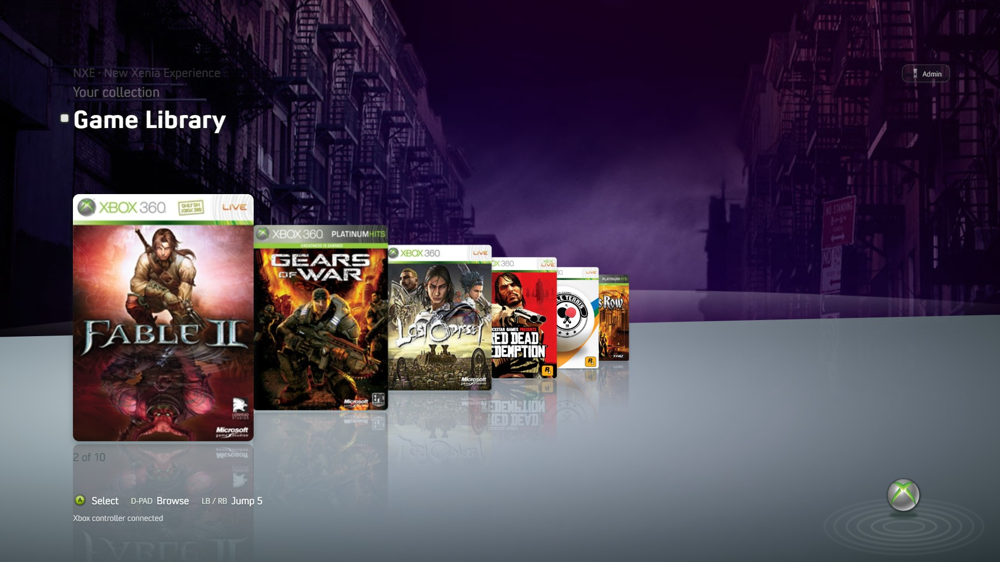
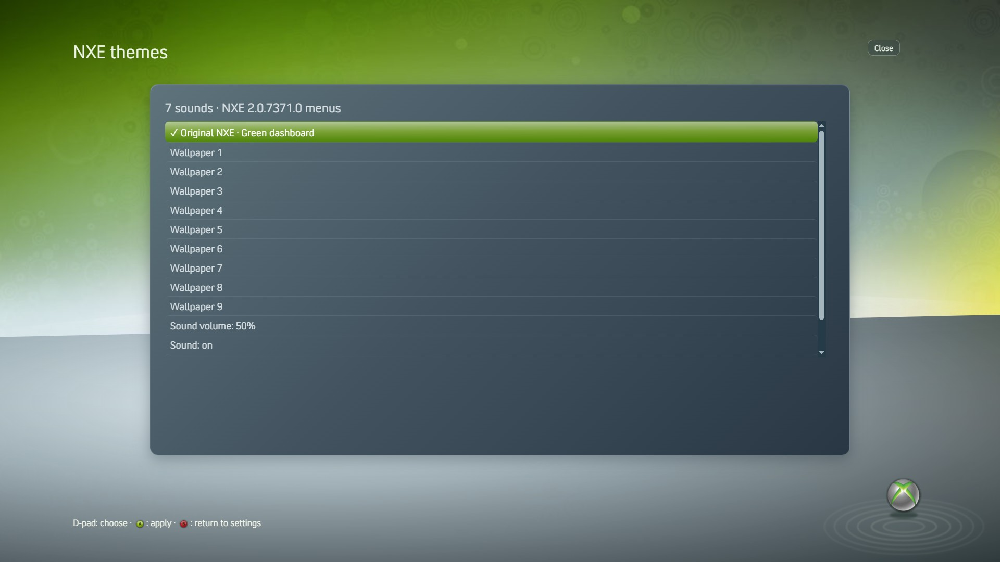

# NXE — New Xenia Experience

A fullscreen, controller-first launcher that gives your Xenia Canary game library the look and feel of the Xbox 360 NXE dashboard. Built-in wallpapers, interface sounds, and background music work offline. Supply your own Xenia installation and games.



[Windows setup](#windows-setup) · [Linux Mint setup](#linux-mint-setup) · [Controls](#controls-and-first-setup) · [Build from source](#run-and-build-from-source)

## Features

- **Cover-flow library:** rounded, full-size box art with reflections; D-pad/stick navigation and LB/RB shortcuts.
- **Multi-disc games:** one game tile opens a secondary disc carousel, with shared artwork and numbered disc choices.
- **Cover tools:** download missing artwork, confirm matches, replace a wrong downloaded cover, or rescan local images.
- **Built-in themes and sound:** the original green dashboard, Wallpaper 1–9, navigation cues, and looping background music.
- **Administrator settings:** Start-button access, optional PIN protection, native file pickers, and mouse/keyboard support.
- **Game handoff:** on Windows, keep Xenia's startup window behind the dashboard until fullscreen settles; restore the dashboard and restart its music when the emulator exits.

## Screenshots

Current **v1.9.0** captures use a demo library, scripted controller state, and sample configuration paths. Click an image to view its full 1920×1080 capture.

| Disc carousel | Administrator settings |
| --- | --- |
| [](docs/screenshots/disc-carousel.jpg) | [](docs/screenshots/administrator-settings.jpg) |
| A opens the disc picker; select a disc with A or return to the library with B. | Configure ROMs, Xenia, runner options, covers, themes, and PIN protection. |
| Cover management | Offline fallback |
| [](docs/screenshots/cover-tools.jpg) | [](docs/screenshots/offline-fallback.jpg) |
| Correct downloaded artwork without changing ROM files. | Missing artwork gets a green disc tile and a readable title. |

## Wallpaper examples

Choose the original green dashboard or Wallpaper 1–9 under **Admin → NXE Themes**.

| Wallpaper 1 | Wallpaper 5 | Wallpaper 9 |
| --- | --- | --- |
| [](docs/screenshots/wallpaper-1.jpg) | [](docs/screenshots/wallpaper-5.jpg) | [](docs/screenshots/wallpaper-9.jpg) |

<details>
<summary>Wallpaper and sound controls</summary>



Volume, mute, and Test sound are available in the same menu. Preferences save immediately.

</details>

## Windows setup

Run the supplied **NXE Setup VERSION.exe** installer, then launch NXE from its desktop or Start menu shortcut. The installer includes Electron, dashboard assets, and audio; Node.js/npm are not required. Xenia Canary and games are installed separately.

For a source checkout, follow the commands below. Run `npm run shortcut` to create a desktop shortcut; recreate it if you move the checkout.

## Linux Mint setup

Use a 64-bit Intel/AMD Mint desktop. NXE runs natively; Xenia's Windows executable runs through Wine or a configured Proton runner. Linux Mint runtime testing remains pending.

**Debian package:** obtain a Linux-built `nxe-launcher_VERSION_amd64.deb`, double-click it in the file manager, and install it through Mint's package installer. Launch NXE from the application menu. Alternatively:

```sh
sudo apt install ./nxe-launcher_VERSION_amd64.deb
```

**AppImage:** obtain a Linux-built `NXE-VERSION.AppImage`, enable **Properties → Permissions → Allow executing file as program**, and double-click it. If FUSE is missing, install `libfuse2t64` on Mint 22.x or `libfuse2` on Mint 21.x. See the [AppImage FUSE guide](https://docs.appimage.org/user-guide/troubleshooting/fuse.html). For sandbox errors, prefer the Debian package; do not disable Electron's sandbox.

Install Wine using Software Manager or:

```sh
sudo apt update
sudo apt install wine
```

Keep Xenia in a writable folder, verify it independently, then configure NXE using Linux paths such as:

```text
ROM directory:    /home/YOUR_USER/Games/Xbox360
Xenia executable: /home/YOUR_USER/Emulators/Xenia/xenia_canary.exe
Linux runner:     wine
Runner arguments: []
```

For Proton, use the absolute Proton script path and `["run"]` arguments. Supply `STEAM_COMPAT_DATA_PATH` and `STEAM_COMPAT_CLIENT_INSTALL_PATH` in the launch environment when required. The runner must remain active until Xenia exits. NXE does not install Xenia, runners, or graphics drivers.

## Controls and first setup

1. Connect a standard-mapped Xbox controller. D-pad/left stick browses, A selects/launches, and LB/RB jumps five games.
2. Press **Start** or click **Admin**. The initial PIN is **1234**.
3. Choose **Browse ROM** and **Browse Xenia**, then **Save and rescan**.
4. Change the initial PIN with **New PIN** and save before child/unattended use. Leave PIN protection enabled for restricted access, or turn it off for direct admin access.

PIN controls: D-pad chooses, A enters, X erases, Y submits, and B cancels. Keyboard typing, Tab/Enter/Escape, paste, and native mouse/keyboard file pickers also work.

Admin sessions expire after five minutes and end when returning to games or launching a game. **Exit to Desktop** is the final menu option. Disabling PIN protection allows anyone to change settings and exit.

## Games and artwork

The scanner searches real subdirectories for `.iso`, `.xex`, and `.god` files. It skips symlinks. Local `ROM_NAME.png`, `.jpg`, or `.jpeg` sidecars take priority over cached downloads.

Under **Download missing covers**, choose missing artwork downloads, **Replace a downloaded cover**, or **Rescan local cover images**. Confirm the matching title before downloading. Artwork comes from [x360db](https://github.com/xenia-manager/x360db) and is cached locally. These tools use the saved ROM directory; save changed paths first.

Explicit numbered filenames such as `Blue Dragon (Disc 1).iso` and `(Disc 2).iso` group into one tile. Different editions/regions, formats, or duplicate disc numbers remain separate. Original files and per-disc caches are preserved. The secondary carousel chooses the starting disc; in-game swapping remains [Xenia Canary's own disc picker](https://github.com/xenia-canary/xenia-canary/blob/canary_experimental/src/xenia/kernel/xam/xam_content.cc).

## Themes, music, and startup

The default green dashboard and nine other wallpapers are built in. **NXE Themes** controls volume and mute for both navigation cues and background music. Music loops in the dashboard, stops at game launch, and restarts from the beginning when the emulator closes or launch fails. Wallpaper changes retain its playback position.

On Windows, a native helper arms before launch, shields the startup window, and waits for 1.8 seconds of stable fullscreen before handing over. It has bounded timeout fallbacks. Game-specific loading may continue after handoff. Linux uses the normal Wine/Proton window transition.

Convection is used when installed; it is not bundled. System fonts provide a fallback.

## Run and build from source

Install Node.js 22 or newer, npm, and Git:

```sh
git clone https://github.com/OrthoDad38/NXE.git
cd NXE
npm ci
npm run start
```

Update an existing checkout with `git pull` and `npm ci`. Close NXE before updating.

```sh
npm test
npm run build:windows
# On a Linux build host:
npm run build:linux
```

Build on the target OS; do not copy Windows `node_modules` to Linux. Outputs are in `dist/`: Windows NSIS installer, Linux Debian package, and AppImage. Builds are unsigned and not automatically published.

## Settings and kiosk limits

Settings and caches use Electron's userData folder, normally `%APPDATA%/NXE` or `~/.config/NXE`. Existing profiles are detected automatically. PINs are stored as salted hashes.

Fullscreen kiosk mode blocks app close/navigation/devtools controls, but OS shortcuts, task managers, compositor bindings, and physical access require account/OS restrictions. Use a limited kiosk account for child use. The launcher alone is not a security boundary.

## Validation and licenses

Windows packaging, renderer/IPC tests, native window handoff, and an isolated Xenia/Fable II startup check have been verified. Physical controller coverage and Linux Mint runtime testing remain target-machine checks. See [VALIDATION.md](VALIDATION.md).

See [SECURITY.md](SECURITY.md) for the security review, protections, and release checks.

Source code is MIT licensed. Dashboard assets, recordings, game artwork, and Xbox trademarks retain their respective ownership. See [asset attribution](assets/ATTRIBUTION.md), [dashboard resources](NXE-ASSETS.md), and [FFmpeg notice](FFMPEG-NOTICE.md).
